# Flippin — Flow Document

Companion to [01-PRD.md](01-PRD.md) and [02-FEATURES.md](02-FEATURES.md). Diagrams are Mermaid (render on GitHub, VS Code, Obsidian).

## Index
| ID | Flow | Actors |
|---|---|---|
| F-00 | System architecture | all |
| F-01 | First launch & onboarding | Customer |
| F-02 | Authentication | Customer / all |
| F-03 | Address & zone detection | Customer, API |
| F-04 | Browse → cart → checkout | Customer |
| F-05 | Scheduled order | Customer, API |
| F-06 | Payment (Moyasar / COD / wallet) | Customer, API, Moyasar |
| F-07 | Order lifecycle (state machine) | all |
| F-08 | Vendor order handling | Store |
| F-09 | Rider dispatch & delivery | Rider, API, Admin |
| F-10 | Chat | Customer ↔ Rider |
| F-11 | Cancellation | Customer, Store, Admin |
| F-12 | Grocery substitution | Store, Customer |
| F-13 | Refund | Admin, API, Moyasar |
| F-14 | Ratings & reviews | Customer |
| F-15 | Invoice & ZATCA QR | API |
| F-16 | Support ticket | Customer, Admin |
| F-17 | Account deletion / data export (PDPL) | Customer, API |
| F-18 | Vendor / store onboarding | Vendor, Admin |
| F-19 | Money: ledger, COD settlement, payouts | API, Admin, Rider, Store |
| F-20 | Rider onboarding | Rider, Admin |
| F-21 | Notifications matrix | API |
| F-22 | Rebrand & release pipeline | Developer |

---

## F-00 System architecture

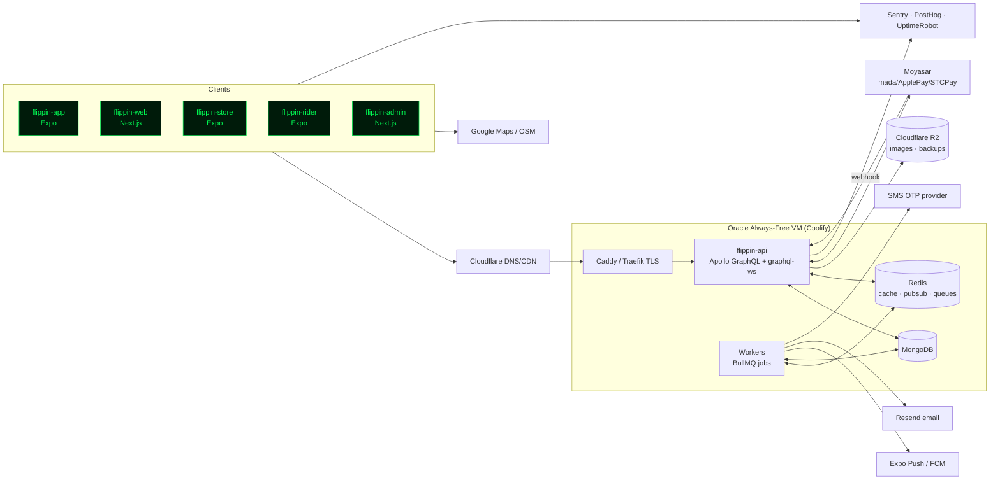

## F-01 First launch & onboarding

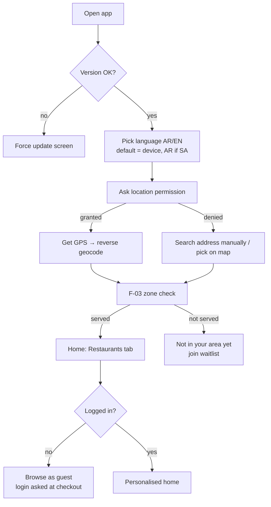

## F-02 Authentication

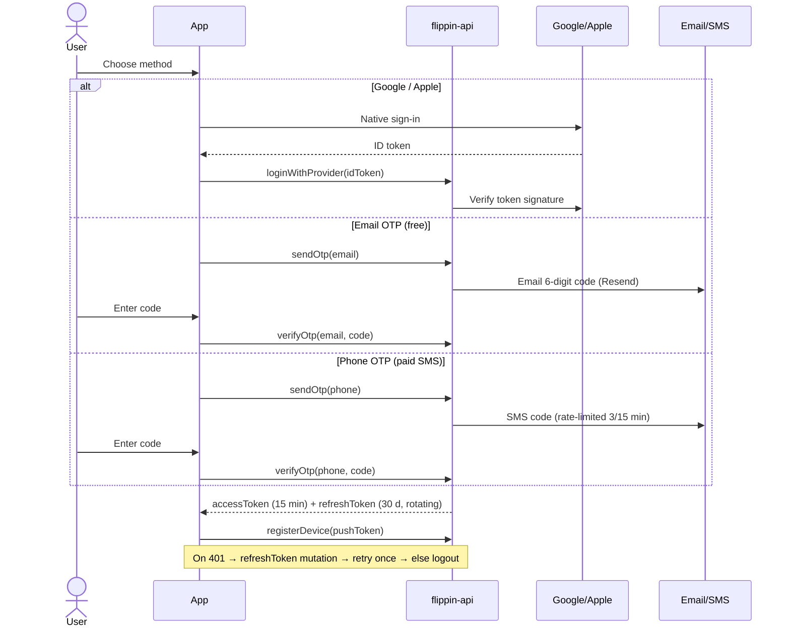

Rules: OTP 6 digits, 5-minute expiry, 5 attempts, then 15-minute lock. Phone must be verified before first COD order. Riders/stores/admins use credentials created by admin (+ admin 2FA).

## F-03 Address & zone detection

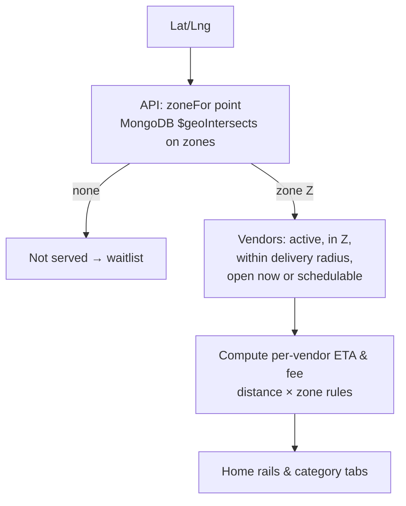

## F-04 Browse → cart → checkout

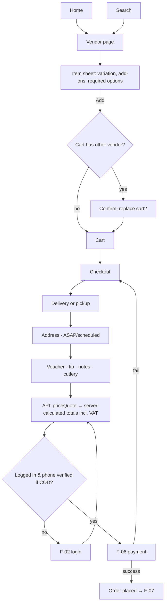

Server validation on `placeOrder`: vendor open/not paused, items available, options valid, min order, zone, coupon valid, price matches quote (else return new quote), COD limit, idempotency key.

## F-05 Scheduled order

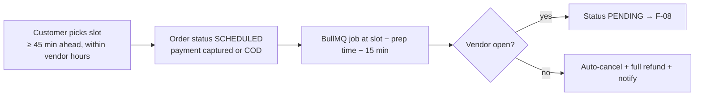

## F-06 Payment

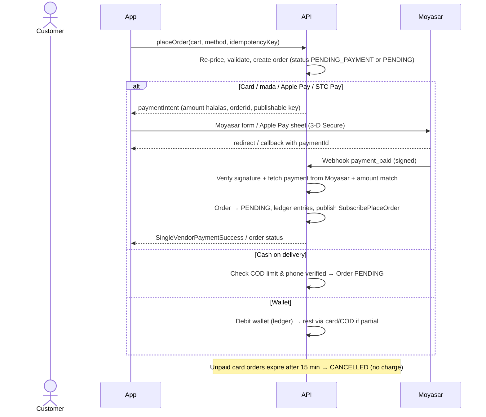

Never mark paid from client callback alone — only after webhook or server-side fetch.

## F-07 Order lifecycle (state machine)

Statuses kept compatible with existing apps: `SCHEDULED, PENDING, ACCEPTED, ASSIGNED, PICKED, DELIVERED, COMPLETED, CANCELLED, CANCELLEDBYREST, REFUNDED`. "Ready" is stored as timestamp `readyAt` (no new status → no client breakage).

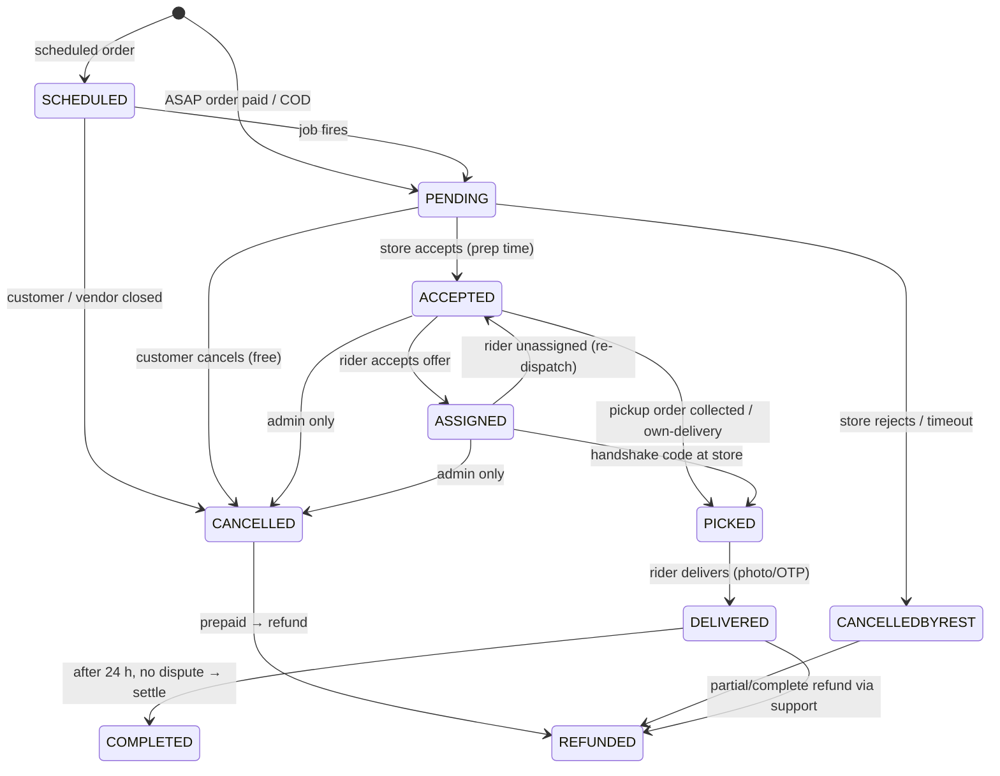

Every transition: validated by role, written to `order.statusHistory`, published on `SubscriptionOrder` / `SubscriptionOrderTracking`, triggers F-21 notifications, and logged in audit if done by admin.

## F-08 Vendor order handling

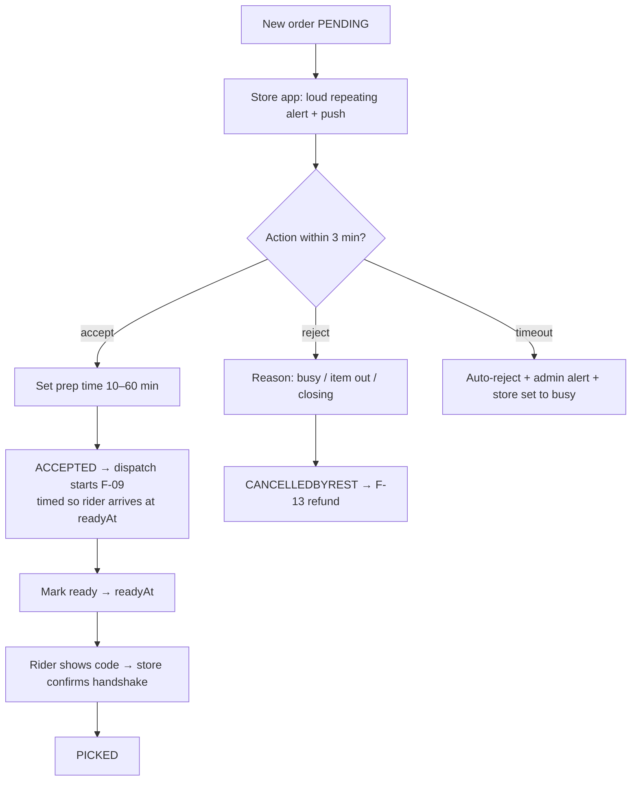

## F-09 Rider dispatch & delivery

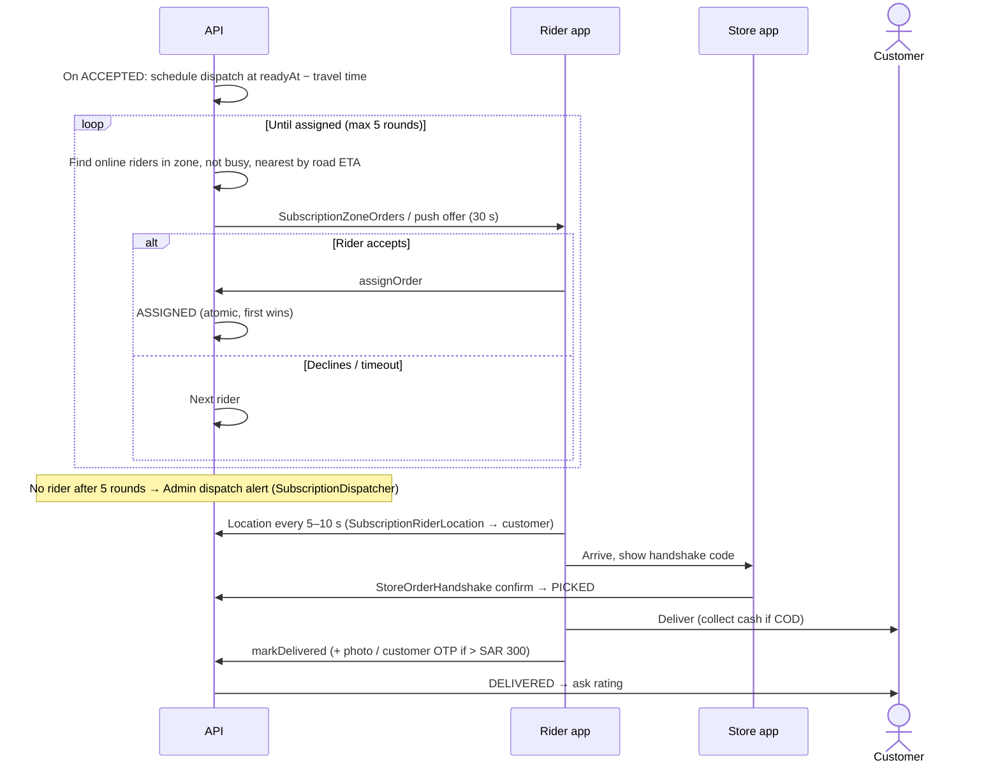

Own-delivery stores (S-18): store staff account acts as rider for its own orders; dispatch step skipped.

## F-10 Chat

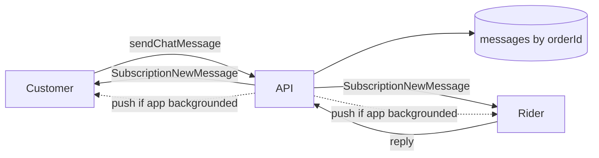
Chat open from ASSIGNED to DELIVERED + 1 h; read-only after. Phone numbers hidden in text (regex mask) — P2 masked calling.

## F-11 Cancellation policy

| When | Who | Result |
|---|---|---|
| PENDING (before accept) | Customer | Free cancel, full refund |
| ACCEPTED / ASSIGNED | Customer | Request → support; vendor may charge food cost (admin decides) |
| Any before PICKED | Store | Allowed with reason → full refund, store penalty counter |
| Any | Admin | Allowed, choose refund amount + who bears cost (platform/store/rider) |
| PICKED onward | — | No cancel; use F-16 problem report |

## F-12 Grocery substitution

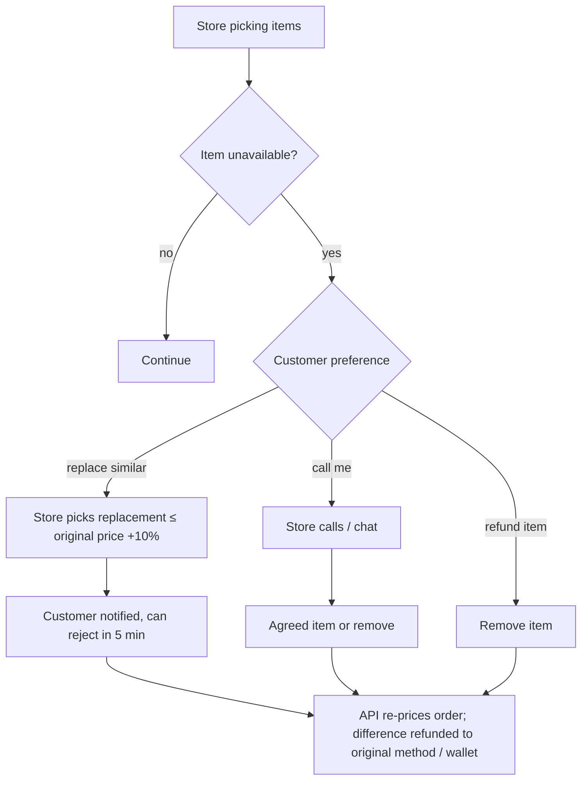

## F-13 Refund

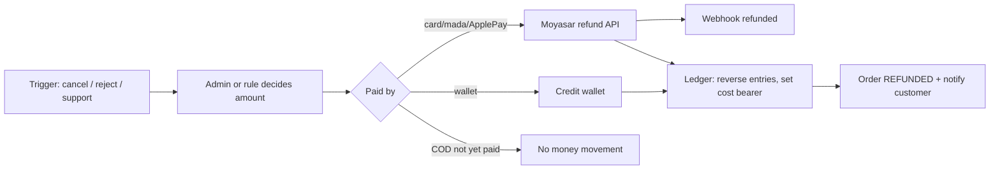
Default for support complaints: instant wallet credit (fast, no gateway fee); card refund on request.

## F-14 Ratings & reviews
DELIVERED → push "Rate your order" → rate vendor (1–5 + tags + comment) and rider (1–5 + tags) → vendor rating = rolling average of last 200; ratings ≤ 2 open an auto support ticket; reviews moderated (profanity filter, admin hide).

## F-15 Invoice & ZATCA QR

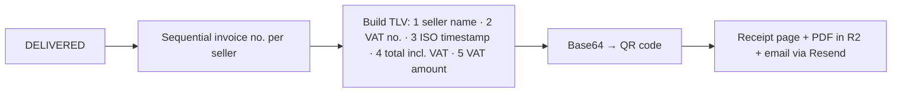
Two invoices when needed: vendor → customer (food) and Flippin → customer (delivery/service fees); Flippin → vendor (commission) monthly. Confirm model with accountant. Phase 2 (Fatoora API clearance/reporting) in plan Phase 6.

## F-16 Support ticket
Customer: Order → "Report a problem" → pick reason (missing item, wrong item, late, quality, rider behaviour, other) → photo optional → ticket created with order snapshot → auto-rules (e.g. missing item ≤ SAR 30 → instant wallet credit) → else admin queue → admin chats, resolves (refund F-13 / credit / reject) → customer notified → CSAT thumbs up/down.

## F-17 Account deletion & data export (PDPL)
Request in app → re-authenticate → 14-day grace (login cancels) → job: anonymise user (name → "Deleted user", phone/email hashed), delete addresses, tokens, devices; keep orders/invoices for tax retention period (anonymised) → confirmation email. Export: job builds JSON (profile, addresses, orders) → signed R2 link emailed, expires in 7 days.

## F-18 Vendor / store onboarding

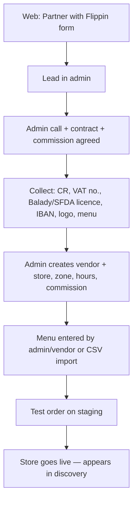

## F-19 Money: ledger, COD settlement, payouts

Double-entry ledger accounts per order: `customer`, `vendor:{id}`, `rider:{id}`, `platform:commission`, `platform:fees`, `vat:payable`, `gateway:clearing`, `rider:cash_held`.

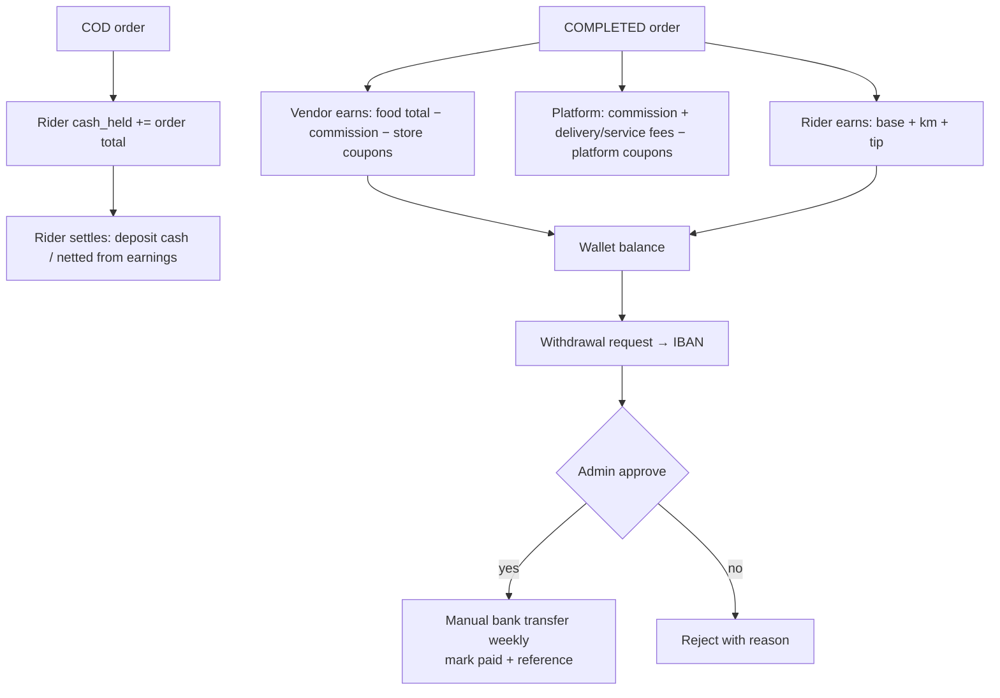
Riders with cash_held > SAR 1,000 stop receiving COD orders until settled.

## F-20 Rider onboarding
Web `/rider` form → lead → documents (Iqama/ID, licence, vehicle registration, freelance permit / company letter per TGA rules, IBAN, photo) → admin verifies → account created, zone + vehicle set → training checklist in app → first shift. Documents expiry tracked; expired → auto offline.

## F-21 Notifications matrix

| Event | Customer | Store | Rider | Admin |
|---|---|---|---|---|
| Order placed | push + in-app | alarm + push | — | live board |
| Accepted (ETA) | push | — | — | — |
| Rejected / timeout | push + refund note | — | — | alert (timeout) |
| Rider offer | — | — | push + sound | — |
| No rider found | — | — | — | alert |
| Rider assigned | push | in-app | — | — |
| Picked up | push | — | — | — |
| Near you (≤ 500 m) | push | — | — | — |
| Delivered | push + e-receipt email | in-app | — | — |
| Chat message | push if bg | — | push if bg | — |
| Refund issued | push + email | — | — | — |
| Withdrawal processed | — | push | push | — |
| Payment webhook failure | — | — | — | email alert |

## F-22 Rebrand & release pipeline

```mermaid
flowchart LR
  A[Branch rebrand/flippin] --> B[Scripted rename<br/>folders · packages · ids · urls]
  B --> C[Manual review: translations, legal, assets]
  C --> D[Replace secrets → env]
  D --> E[CI: typecheck · lint · test · schema-compat · build]
  E --> F[grep -ri enatega = only LICENSE/NOTICE]
  F --> G[Merge → Coolify deploy staging]
  G --> H[EAS build preview → internal testers]
  H --> I[Prod: web/admin via Coolify, apps via EAS submit]
```
